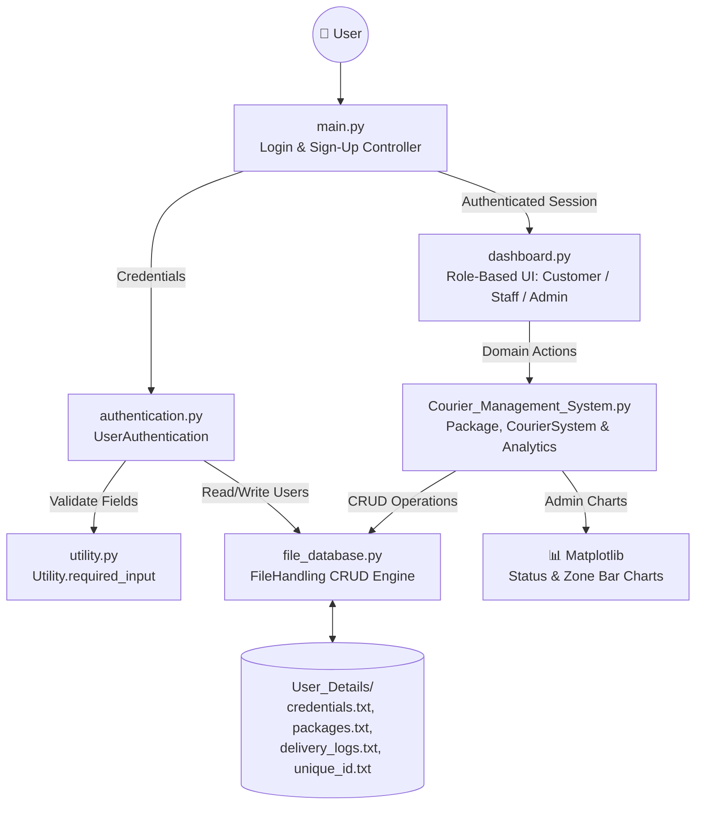

<div align="center">

# 📦 Courier Delivery & Package Tracking System

**A modular, role-based Command-Line Interface (CLI) logistics and shipment tracking system built with Python.**


*Book shipments • Assign delivery agents • Track real-time locations • Log delivery attempts • Visualize performance analytics*

</div>

---

## 📑 Table of Contents

- [Overview](#-overview)
- [Key Features](#-key-features)
- [System Architecture](#-system-architecture)
- [Project Structure](#-project-structure)
- [Role-Based Access Control](#-role-based-access-control)
- [Pricing & Business Rules](#-pricing--business-rules)
- [Getting Started](#-getting-started)
- [How to Use (Quick Walkthrough)](#-how-to-use-quick-walkthrough)
- [Data Storage Format](#-data-storage-format)
- [Team](#-team)

---

## 🌟 Overview

The **Courier Delivery & Package Tracking System** automates end-to-end parcel operations without requiring an external database server. Built around a clean **6-module layered architecture**, it features user authentication, persistent auto-incrementing IDs (`CUST` & `TRK`), a custom flat-file CRUD storage engine, role-specific dashboards (**Customer**, **Staff**, and **Admin**), and visual delivery analytics powered by **Matplotlib**.

---

## ✨ Key Features

- 🔐 **Authentication & Sign-Up Flow** — Email/password login with interactive account registration and empty-field validation.
- 👥 **Role-Based Dashboards** — Dedicated CLI workflows for **Customers**, **Staff**, and **Admins**.
- 🆔 **Auto-Generated Unique IDs** — Persistent sequential IDs for customers (`CUST0001`, `CUST0002`, ...) and shipments (`TRK0001`, `TRK0002`, ...).
- 🚚 **Complete Shipment Lifecycle** — Create shipments, assign agents, update live locations, and log delivery attempts with timestamps and remarks.
- ⚠️ **Automated Failure Detection** — Shipments are automatically marked `Failed` after **3 unsuccessful delivery attempts**.
- 🗄️ **Custom Flat-File CRUD Engine** — Zero-dependency text database (`FileHandling`) with built-in delimiter sanitization.
- 📊 **Reports & Visual Analytics** — Console-based performance summaries plus Matplotlib bar charts for **Delivery Status** and **Zone Performance**.

---

## 🏗️ System Architecture



---

## 📂 Project Structure

```text
courier-delivery-system/
├── main.py                         # Entry point & Login/Sign-Up CLI loop
├── authentication.py               # User sign-in, sign-up & credential verification
├── dashboard.py                    # Role selection & Customer/Staff/Admin menus
├── Courier_Management_System.py    # Core business logic, tariffs, reports & Matplotlib charts
├── file_database.py                # Custom flat-file CRUD engine & ID counter manager
├── utility.py                      # Input validation helper
└── User_Details/                   # Auto-created at runtime for persistent storage
    ├── credentials.txt             # Registered user/customer profiles
    ├── packages.txt                # Shipment records
    ├── delivery_logs.txt           # Timestamped delivery attempt audit logs
    └── unique_id.txt               # Persistent CUST & TRK ID counters
```

---

## 🛡️ Role-Based Access Control

After logging in, choose a role to access its dedicated menu:

| Role | Permissions & Available Actions |
| :--- | :--- |
| **👤 Customer** | • Create new shipments (automatically linked to your `CUST` ID)<br>• View all your personal packages and detailed tracking instructions |
| **🚚 Staff** | • View unassigned packages & assign delivery agents<br>• Update current package locations<br>• Record delivery attempts (Success / Failed with remarks)<br>• Track any package by Tracking ID |
| **👑 Admin** | • Track any package<br>• View all registered users & shipment records<br>• Delete shipments permanently<br>• Generate console performance reports<br>• Launch Matplotlib visual analytics charts |

---

## 💰 Pricing & Business Rules

### Delivery Charge Formula
```text
Total Charge = Rs. 50.00 (Base) + (Weight in kg × Rs. 10.00) + Tier Surcharge
```

| Package Type | Surcharge | Handling Instructions |
| :--- | :---: | :--- |
| **Standard** | `Rs. 0.00` | Standard ground delivery. |
| **Fragile** | `Rs. 80.00` | Fragile: do not stack; handle with extreme caution. |
| **Express** | `Rs. 150.00` | Priority Express: handle carefully and prioritize delivery. |

### Operational Constraints
- **Valid Delivery Zones:** `North`, `South`, `East`, `West`, `Central`
- **Available Delivery Agents:** `Agent_John`, `Agent_Sarah`, `Agent_Mike`, `Agent_Emma`
- **Delivery Attempt Limit:** A package must have an assigned agent before logging attempts. After **3 failed attempts**, its status automatically changes to `Failed`. Once `Delivered`, its location and agent cannot be modified.

---

## 🚀 Getting Started

### Prerequisites
- **Python 3.8+** installed on your system
- **pip** (Python package manager)

### Installation

1. **Clone the repository**
   ```bash
   git clone https://github.com/<your-username>/<your-repo-name>.git
   cd <your-repo-name>
   ```

2. **Install the required dependency (`matplotlib`)**
   ```bash
   pip install matplotlib
   ```

3. **Run the application**
   ```bash
   python main.py
   ```

> 💡 **Note:** You do not need to manually create the `User_Details/` folder or any `.txt` files—the application initializes them automatically on first launch.

---

## 🧭 How to Use (Quick Walkthrough)

Want to test the entire workflow in 2 minutes? Follow these steps:

1. **Create an Account**
   - Launch `python main.py`.
   - Enter any email and password. Since it's your first time, the system will prompt you to sign up (`y`), ask for your **Name** and **Phone**, and assign you `CUST0001`.
2. **Book a Shipment (Customer Role)**
   - Select **`[1] Customer`** → **`[1] Create Shipment`**.
   - Choose a package type (e.g., `Express`), enter weight (e.g., `2.5`), and pick a zone (e.g., `North`).
   - Note your generated Tracking ID (e.g., `TRK0001`) and logout (`[0]`).
3. **Dispatch & Deliver (Staff Role)**
   - Log back in and select **`[2] Staff`**.
   - Use **`[1] Assign Agent`** to assign `Agent_John` to `TRK0001`.
   - Use **`[2] Update Location`** to update its transit hub.
   - Use **`[3] Record Delivery Attempt`** to mark it delivered (`y`) or log a failed attempt (`n`).
4. **View Analytics (Admin Role)**
   - Log back in and select **`[3] Admin`**.
   - Choose **`[4] Performance Report`** for a terminal breakdown or **`[5] Show Charts`** to open the Matplotlib bar graphs.

---

## 🗄️ Data Storage Format

Records are persisted inside `User_Details/` using a custom human-readable `[key=value]` format managed by `FileHandling` (`file_database.py`):

```text
[tracking_id=TRK0001,customer_id=CUST0001,type=Express,weight=2.5,zone=North,date=2026-11-20,status=In Transit,agent=Agent_John,attempts=0,location=With Agent_John,charge=225.00]
```

Reserved characters (`,`, `=`, and newlines) are automatically sanitized via `_clean()` to prevent file corruption.

---

## 👨‍💻 Team

Built as a collaborative Python Software Engineering project (**Problem ID: 25**):

| Team Member | Key Contributions |
| :--- | :--- |
| **Kumar Harsh** | Modular Architecture, User Authentication (`authentication.py`, `main.py`), Auto-Increment ID Generator |
| **Saksham Mishra** | Role-Based Dashboard UI (`dashboard.py`), Staff & Customer Workflow UX |
| **Sohhng Satsangi** | Custom Flat-File CRUD Engine (`file_database.py`), Data Persistence & Integration Testing |
| **Suryansh Bhatt** | Core Shipment & Delivery Logic (`Courier_Management_System.py`), Performance Reports & Matplotlib Analytics |

---

<div align="center">
  <sub>If you found this project helpful, feel free to ⭐ the repository!</sub>
</div>